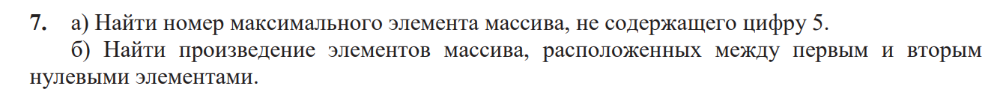
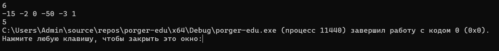
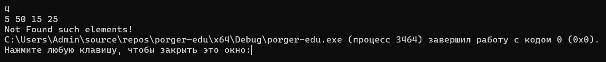
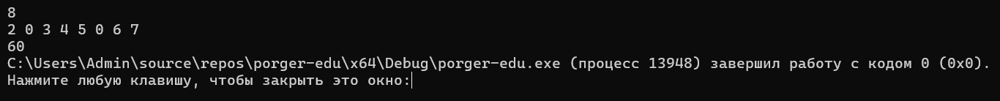
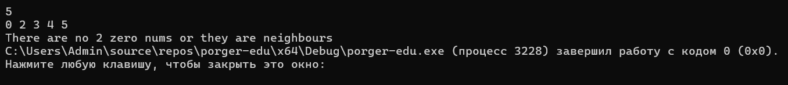

## 📋 Условие задачи

## Код решения

[mainA.cpp](mainA.cpp).
[mainB.cpp](mainB.cpp).

### Тест A1

**Ввод:** `-15 -2 0 -50 -3 1`

**Ожидаемый результат:** `5`

### Тест A2

**Ввод:** `5 50 15 25`

**Ожидаемый результат:** `Not Found such elements!`

### Тест B1

**Ввод:** `2 0 3 4 5 0 6 7`

**Ожидаемый результат:** `60`

### Тест B2

**Ввод:** `0 2 3 4 5`

**Ожидаемый результат:** `There are no 2 zero nums or they are neighbours`

